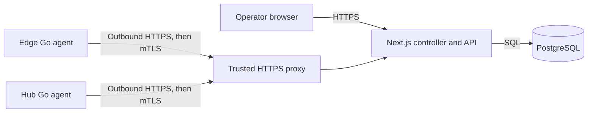

# PacketMotion Fabric

PacketMotion Fabric is an L3-first SD-WAN controller and agent for managing Edge and Hub devices. This repository contains the Next.js controller, a shared Go agent, PostgreSQL migrations, the management API contract, deployment examples, and project documentation.

## Current capabilities

The implemented MVP provides operator authentication, a protected device inventory, one-use device enrollment, certificate-based agent identity, management configuration revisions, and agent heartbeat/interface telemetry. The Go agent initiates its connections to the controller and stages desired configuration locally.

**The current agent does not configure or change network forwarding.** WireGuard tunnels, FRRouting BGP, nftables policy, routed reachability, safe apply/rollback, and failover are future milestones. A connected device or successful heartbeat does not prove that customer traffic can pass.

The controller is a Next.js application with PostgreSQL. One Go binary serves both Edge and Hub roles. There is no separate Go controller service.

## Architecture



The controller owns inventory, enrollment, device certificates, desired revisions, acknowledgements, and persisted telemetry. Agents own their local identity, outbound polling, typed configuration staging, and telemetry collection. See the [architecture decisions](docs/adr/README.md) and [network design](docs/architecture/network-design.md).

## Repository layout

| Path | Purpose |
| --- | --- |
| `sdwan-controller/` | Next.js operator UI, API, PostgreSQL access, migrations, and controller tests |
| `sdwan-edge/` | Shared Go agent for Edge and Hub devices |
| `api/openapi.yaml` | Management API contract |
| `deploy/` | Reverse proxy and systemd deployment examples |
| `docs/` | Product requirements, architecture, status, operations, and evidence |
| `tests/` | Repository-level tooling tests |

## Getting started

### Controller development

Requirements: Node.js 22.12.0 or newer, npm, and a local PostgreSQL instance. The controller's `.nvmrc` records the repository's selected Node version. Follow the [controller README](sdwan-controller/README.md) for environment setup, migrations, initial operator creation, and local startup.

```sh
cd sdwan-controller
npm ci
cp .env.example .env.local
# Set DATABASE_URL in .env.local, then follow the controller setup steps.
```

Do not replace an existing `.env.local`; preserve its credentials and settings. The controller guide documents the full setup sequence, including database migrations and generating the first admin credential.

### Go agent development

Requirements: Go 1.27.2 (as pinned by `sdwan-edge/go.mod`). Build and run Go checks from `sdwan-edge/`:

```sh
go test ./...
go vet ./...
go build -o bin/fabric-agent ./cmd/fabric-agent
```

Enrollment requires a controller reachable over HTTPS, a registered device, and a one-use enrollment token. See the [Go agent README](sdwan-edge/README.md) for safe enrollment and runtime instructions. Keep device keys and private state out of version control.

## Verification

Run controller checks from `sdwan-controller/`:

```sh
npm test
npm run lint
npm run typecheck
npm run build
```

Integration and browser tests require the isolated test setup described in the [testing strategy](docs/development/testing-strategy.md) and controller README. Agent-channel smoke tests additionally require Docker, OpenSSL, and Go 1.27.2. Follow the documented test strategy; a local unit test does not replace VM-based network validation.

## Security and deployment notes

- Keep `.env.local`, database credentials, enrollment tokens, private keys, and agent state private.
- Production enrollment and agent traffic require the trusted HTTPS/mTLS proxy boundary described in [proxy deployment](deploy/proxy/README.md) and the [security model](docs/architecture/security-model.md).
- Apply controller migrations with `npm run migrate:controller` before deploying code that depends on them.
- The included proxy and systemd files are deployment examples; live public ingress and Debian service deployment are not claimed as verified here.
- Do not run provisioning scripts or network changes on a production host without reviewing their effects and rollback path.

## Documentation

- [Product requirements](docs/prd/packetmotion-fabric-v1.1.md)
- [Current delivery status and unverified work](docs/STATUS.md)
- [Implementation plan](docs/development/implementation-plan.md)
- [Testing strategy](docs/development/testing-strategy.md)
- [Architecture and security](docs/README.md)
- [Runtime error troubleshooting](docs/operations/runtime-error-troubleshooting.md)
- [Change log](docs/change-logs/README.md)
- [Repository contribution and agent rules](AGENTS.md)

## Project status

Management-plane enrollment and telemetry are implemented. Network-plane generation, apply/rollback, and real lab failover remain pending. Check [delivery status](docs/STATUS.md) before relying on a capability or deployment path.
