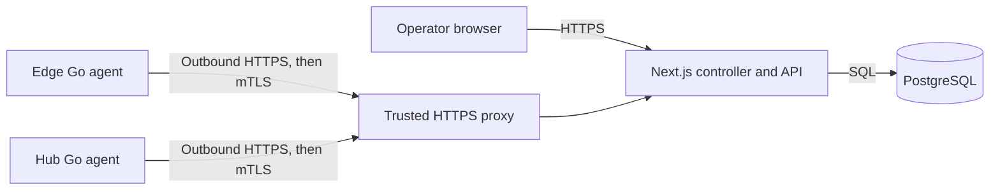

# PacketMotion Fabric

PacketMotion Fabric is an L3-first SD-WAN controller and agent for managing Edge and Hub devices. This repository contains the Next.js controller, a shared Go agent, PostgreSQL migrations, the management API contract, deployment examples, and project documentation.

## Current capabilities

The implemented MVP provides operator authentication, a protected device inventory, one-use device enrollment, certificate-based agent identity, management configuration revisions, and agent heartbeat/interface telemetry. The Go agent initiates its connections to the controller and stages desired configuration locally.

**The current agent does not configure or change network forwarding.** WireGuard tunnels, FRRouting BGP, nftables policy, routed reachability, safe apply/rollback, and failover are future milestones. A connected device or successful heartbeat does not prove that customer traffic can pass.

The controller is a Next.js application with PostgreSQL. One Go binary serves both Edge and Hub roles. There is no separate Go controller service.

## Architecture



The controller owns inventory, enrollment, device certificates, desired revisions, acknowledgements, and persisted telemetry. Agents own their local identity, outbound polling, typed configuration staging, and telemetry collection. See the [architecture decisions](docs/adr/README.md) and [network design](docs/architecture/network-design.md).

## Repository layout

| Path | Purpose |
| --- | --- |
| `sdwan-controller/` | Next.js operator UI, API, PostgreSQL access, migrations, and controller tests |
| `sdwan-edge/` | Shared Go agent for Edge and Hub devices |
| `api/openapi.yaml` | Management API contract |
| `deploy/` | Reverse proxy and systemd deployment examples |
| `docs/` | Product requirements, architecture, status, operations, and evidence |
| `tests/` | Repository-level tooling tests |

## Deploy from scratch

Target: a clean Debian 12/13 controller host and one or more clean Debian Edge/Hub hosts, all as `root` (or `sudo`). Do the phases in order. Each phase ends with a check; do not continue until it passes.

### Phase 0 — Prerequisites

| Host | Needs |
| --- | --- |
| Controller | Debian 12/13, static or reserved IPv4, Node.js 22.12.0+ with npm, git, and PostgreSQL (the lab setup can start a PostgreSQL container for you) |
| Edge / Hub | Debian 12/13, systemd, outbound reachability to the controller's HTTPS address |

```sh
apt-get update && apt-get install -y git curl ca-certificates
node -v    # must print v22.12.0 or newer; install Node first if not
```

### Phase 1 — Controller node

```sh
git clone <repository-url> /opt/packetmotion-sdwan   # use your repository URL
cd /opt/packetmotion-sdwan

# 1. Preview: scans interfaces, validates, prints the plan, changes nothing.
sudo deploy/controller/setup-controller.sh --dry-run

# 2. Real run: interactive wizard.
sudo deploy/controller/setup-controller.sh
```

The wizard asks for:

1. **Serving interface and IP.** NGINX listens only on this address. Edges must be able to reach it.
2. **Mode.** `lab` (isolated network, optional HTTP installer on port 80, root service allowed) or `production` (HTTPS only, non-root service account).
3. **Certificate.** `private-ca` (self-signed; edges pin its fingerprint) or `custom` (your public or enterprise cert: `--tls custom --tls-cert fullchain.pem --tls-key key.pem`).
4. **PostgreSQL.** Host, port, database, user and password. In lab mode with no database configured, it can install Docker and run PostgreSQL 17 for you.

It then runs migrations, creates the first superadmin, builds the controller and starts `packetmotion-controller.service`.

**Save the generated superadmin email and password shown at the end; the password is printed once.**

Use a stable DNS name or IP as the host. Agents store the controller URL, so changing it later orphans enrolled devices.

Check the controller:

```sh
systemctl status packetmotion-controller nginx --no-pager
curl -k https://<controller-ip>/api/ready
```

Then open `https://<controller-ip>/login` and sign in. With `private-ca` your browser will warn about the certificate; that is expected.

Unattended example (lab, container PostgreSQL):

```sh
sudo deploy/controller/setup-controller.sh --mode lab --interface ens33 --address 192.168.160.200 \
  --tls private-ca --setup-postgres --non-interactive --yes
```

All options: `deploy/controller/setup-controller.sh --help`. Details: [controller installation](docs/operations/controller-installation.md).

### Phase 2 — Prepare each Edge/Hub host (bootstrap, once per host)

Phases 4 and 5 refer back to this. Skip it if the host already has Debian, FRR, WireGuard and nftables installed and configured. Otherwise, on the **Edge/Hub host**, copy the bootstrap script over and run it from an interactive root terminal:

```sh
scp sdwan-edge/sdwan-provisioning-scripts/packetmotion-fabric-bootstrap-v1.8.sh root@<edge-ip>:/root/
# on the Edge host:
bash /root/packetmotion-fabric-bootstrap-v1.8.sh
```

It sets the hostname and uplink, updates packages, installs FRR/WireGuard/nftables, enables kernel forwarding, configures SSH and ends with a verification table. The log is `/var/log/packetmotion-install.log`. Review [the provisioning guide](sdwan-edge/sdwan-provisioning-scripts/README.md) first: it changes network settings, so run it from the console and not over your only SSH session.

### Phase 3 — Controller one-time settings

Sign in at `https://<controller-ip>/login` as the superadmin, then:

0. Lab mode with the cleartext port-80 installer only: **Settings → Insecure HTTP lab controllers**, add the controller's private IP so generated install commands include `--allow-insecure-local`. Skip in production or when edges use HTTPS.

1. **Settings → Tunnel addressing:** choose an unused private IPv4 pool (for example `10.250.0.0/24`, prefix /16-/30). It must not overlap management, underlay, LAN or VPN routes.
2. **Settings → Protected networks:** add your management and underlay networks (needed before saving LAN profiles).

### Phase 4 — Onboard the Hub first

An Edge can only connect to a Hub that is already enrolled and keyed, so do the Hub first.

1. **Hub host:** complete Phase 2 (bootstrap) if the host is not prepared.
2. **Controller UI:** **Devices → Add device**, role **Hub**, enter a name. Copy the generated install command (contains a one-use token; keep it secret).
3. **Hub host**, as root: paste the command. Shape:
   ```sh
   curl -fsSLo install.sh https://<controller-ip>/fabric/edge.sh   # inspect before running
   sudo bash install.sh --controller https://<controller-ip>   # prompts for the one-time token (hidden)
   ```
   The same installer is used for Hub and Edge. It verifies the signed release, creates the `packetmotion` user, enrolls with the token, starts `fabric-agent.service` and, enables local WireGuard apply by default (`fabric-agent network enable`, agent 0.3.6+; skip with `--management-only`). It prompts for the token, so this is the only command needed on the host.
4. **Verify on the Hub:** `fabric-agent --version`, `systemctl status fabric-agent --no-pager`, `journalctl -u fabric-agent -n 50 --no-pager`.
5. **Verify in the controller:** the Hub is **connected** with a recent heartbeat and has registered its WireGuard public key.
6. **Hub detail page:** set the Hub's reachable underlay IPv4 endpoint and base UDP port (the controller reserves 128 ports per Hub), then **Save draft → Deploy changes**. Open that UDP range on any external firewall or NAT; the agent does not.

### Phase 5 — Onboard each Edge

1. **Edge host:** complete Phase 2 (bootstrap) if the host is not prepared.
2. **Controller UI:** **Devices → Add device**, role **Edge**, enter a name, copy the install command. Each Edge needs its own token.
3. **Edge host:** paste the install command as root (same shape as the Hub).
4. **Verify** on the Edge and in the controller exactly as in Phase 4 steps 4-5.
5. **Edge detail page:** select up to eight available Hubs, then **Save draft → Deploy changes**. Each Edge/Hub pair gets its own /31 and UDP port, and both sides receive their revision.

Repeat Phase 5 for every additional Edge.

### Phase 6 — Tunnel activation (already done by onboarding)

The installer enables local WireGuard apply by default, so Hub and Edge are already allowed to apply tunnels locally. A tunnel comes up once **both ends** have enrolled and you have pressed **Deploy changes** (Phase 4 step 6, Phase 5 step 5). Nothing more to run on the hosts.

Only if a device was enrolled with `--management-only` or an older installer, or activation printed a warning, re-run on that device (identity is kept, no new token needed):

```sh
curl -fsSL https://<controller-ip>/fabric/edge.sh | sudo bash -s -- --controller https://<controller-ip> --enable-wireguard
```

Have console access first, and read [WireGuard tunnels](docs/operations/wireguard-tunnels.md). Then check each device's receipt, **Network apply** and per-interface **last handshake** in the UI, and ping the tunnel IP from the other end. A handshake that stays at zero usually means one end is not activated or the UDP range is blocked.

### Phase 7 — LAN and BGP routing (optional, lab-verified only)

Save a LAN profile per node, then activate locally with `--enable-wireguard --enable-routing --lan-interface <iface>` (see the drop-in example `deploy/systemd/fabric-agent.service.d/routed-lan.conf.example`). Follow [routed LAN](docs/operations/routed-lan.md); appliance rollout and BGP verification are still pending per [delivery status](docs/STATUS.md).

### Troubleshooting

| Symptom | Check |
| --- | --- |
| Setup script stops early | Re-run; it is idempotent. Use `--dry-run` to see blockers (for example, port 3000 or 5432 in use). |
| Controller not responding | `journalctl -u packetmotion-controller -n 100 --no-pager`; `nginx -t` |
| Page shows a reference ID | From `sdwan-controller/`: `npm run errors:show -- <reference-id>` |
| Enrollment fails | Token is one-use: create a new device or token. Confirm the Edge can reach `https://<controller-ip>`; see [agent installation](docs/operations/agent-installation.md). |
| Device never connects | `journalctl -u fabric-agent` on the Edge; check time sync and firewall |

### Update the controller

```sh
cd /opt/packetmotion-sdwan && git pull
sudo deploy/controller/setup-controller.sh   # re-runnable; applies migrations and rebuilds
```

## Development setup

### Controller

Requirements: Node.js 22.12.0 or newer, npm, local PostgreSQL. Follow the [controller README](sdwan-controller/README.md) for details.

```sh
cd sdwan-controller
npm ci
cp .env.example .env.local     # never overwrite an existing .env.local
# set DATABASE_URL, then:
npm run migrate:auth && npm run migrate:controller
npm run init:superadmin        # password printed once
npm run dev
```

### Go agent

Requirements: Go 1.27.2 (pinned by `sdwan-edge/go.mod`). From `sdwan-edge/`:

```sh
go test ./...
go vet ./...
go build -o bin/fabric-agent ./cmd/fabric-agent
```

See the [Go agent README](sdwan-edge/README.md). Keep device keys and private state out of version control.

## Verification

Run controller checks from `sdwan-controller/`:

```sh
npm test
npm run lint
npm run typecheck
npm run build
```

Integration and browser tests require the isolated test setup described in the [testing strategy](docs/development/testing-strategy.md) and controller README. Agent-channel smoke tests additionally require Docker, OpenSSL, and Go 1.27.2. Follow the documented test strategy; a local unit test does not replace VM-based network validation.

## Security and deployment notes

- Keep `.env.local`, database credentials, enrollment tokens, private keys, and agent state private.
- Production enrollment and agent traffic require the trusted HTTPS/mTLS proxy boundary described in [proxy deployment](deploy/proxy/README.md) and the [security model](docs/architecture/security-model.md).
- Apply controller migrations with `npm run migrate:controller` before deploying code that depends on them.
- The included proxy and systemd files are deployment examples; live public ingress and Debian service deployment are not claimed as verified here.
- Do not run provisioning scripts or network changes on a production host without reviewing their effects and rollback path.

## Documentation

- [Product requirements](docs/prd/packetmotion-fabric-v1.1.md)
- [Current delivery status and unverified work](docs/STATUS.md)
- [Implementation plan](docs/development/implementation-plan.md)
- [Testing strategy](docs/development/testing-strategy.md)
- [Architecture and security](docs/README.md)
- [Runtime error troubleshooting](docs/operations/runtime-error-troubleshooting.md)
- [Change log](docs/change-logs/README.md)
- [Repository contribution and agent rules](AGENTS.md)

## Project status

Management-plane enrollment and telemetry are implemented. Network-plane generation, apply/rollback, and real lab failover remain pending. Check [delivery status](docs/STATUS.md) before relying on a capability or deployment path.
