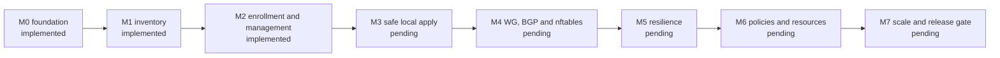

# Delivery status

## Implemented M0/M1

Next.js operator login/logout, PostgreSQL scrypt credentials, signed sessions with credential fingerprint revocation, shared email limiter, auth migration, protected dashboard and liveness route are preserved.

M0 adds locked rotating change logs, isolated PostgreSQL integration/browser tests, pinned Playwright and CI configuration. Go source and a pinned Go toolchain are now part of the M2 agent implementation.

M1 adds checksum-verified serialized additive controller migrations, admin/viewer authorization, persisted site/hub/branch inventory, transactional creation audit, same-origin bounded JSON operator endpoints and inventory controls/list in the existing Devices view. Registration is not enrollment; devices display Not enrolled. The operator flow is Devices -> Add device (Edge or Hub); internal site/network grouping remains hidden and is created transactionally with the device and audit. Devices now contains all onboarding/token instructions and a server-paginated searchable table. Provisioning navigation is removed; obsolete query-based dashboard view URLs no longer select Devices. Per-device URLs reuse agent configuration/telemetry with admin writes and viewer read access. Initial dashboard inventory is bounded to 25 rows; totals cover all devices. Production-scale search performance remains unverified. Existing credentials were verified unchanged during local development migration.

## Implemented management MVP (M2)
Add device issues a hashed, expiring, single-use enrollment token. New token replaces a pending token; revocation invalidates enrollment and device certificates. Next.js issues dedicated client certificates from verified CSRs, and mTLS agent endpoints trust only protected NGINX identity forwarding plus a shared upstream secret. Go agent in sdwan-edge is shared by Edge/Hub, initiates HTTPS, persists keys privately, stages typed desired revisions, sends real heartbeat/interface telemetry and renews certificates. Management Configurations/Telemetry views reuse the existing design.

Rama approved enrollment/Go agent/channel work. No networking apply is implemented: received does not mean applied; controller heartbeat does not mean tunnel/BGP/application reachability. M3–M7 networking scope remains pending. Public HTTPS ingress/CA configuration is required before a VM can enroll. The local VM lab remains Rama's responsibility.

## Verification
Actual per-task results and failed iterations are in [change logs](change-logs/log_change_001.md). PostgreSQL tests cover concurrent one-use enrollment, expired/replaced/revoked credentials, certificate scope, immutable revision/ack integrity, deduplication and audit rollback. The actual Go/NGINX/Next smoke verifies TLS ingress and controller communications. Original baseline and current UI evidence are retained under [evidence](evidence/README.md). Final counts/results are recorded in the milestone closure entry.

Hosted CI, live public ingress deployment, Debian systemd run, WireGuard/FRR/nftables apply/rollback/failover/reboot and scale targets remain UNVERIFIED. Operator role-management UI remains deferred. Enrollment response-loss recovery after consumption requires operator handling; certificate renewal uses overlapping validity to tolerate lost renewal responses.

## Rollback and next step
Disable agent ingress and revert new feature bindings if necessary; preserve additive schema, inventory and audit/change logs. No existing operator credential reset is required. Agent management MVP makes no network changes. Next: configure the HTTPS ingress for Rama's VM lab and plan safe network apply (M3/M4) before routing changes.

## UI consistency audit — 2026-10-12

Shared feedback styles/announcements and typed controller-status labels reduce duplicated markup. Existing Button now covers the password toggle. Device form/table semantics, mobile navigation focus and clipboard failure feedback are verified with the existing desktop/mobile browser suite. Existing theme, auth, routes, APIs and management/data-plane behavior are preserved. Component documentation and permanent root reuse policy are in place; exact verification and limits are recorded in the [UI architecture](development/ui-component-architecture.md) and change log.

Dashboard screens now use `/dashboard`, `/dashboard/devices`, `/dashboard/devices/[id]`, `/dashboard/telemetry`, and `/dashboard/settings`. The shared shell, authorization, and data services remain reused. Legacy `?view=` URLs are not preserved or redirected, per the direct route migration.

## Maintainability and diagnostics — 2026-10-12

`GET /api/health` is the liveness check. `GET /api/ready` checks PostgreSQL with a lightweight query and returns a generic 503 with a request ID when it is unavailable; it never returns driver messages. Unexpected operator and agent API errors include a generated request ID and emit structured stdout metadata with scope, sanitized error class, and constrained error code. Dashboard health/settings sections are application components under `components/fabric/` and preserve the existing markup and tokens.

## Runtime error reports — 2026-10-12

Next.js server errors and uncaught browser runtime errors have friendly recovery UI with a reference ID. Diagnostics persist in PostgreSQL table `runtime_errors`; `/api/runtime-errors` accepts bounded same-origin browser reports from signed-in operators, and server failures are captured by Next.js `onRequestError`. Stored message/stack fields are bounded and redacted; entries older than 30 days are pruned during report writes. Developers can inspect a reference with `npm run errors:show -- <reference-id>` from `sdwan-controller/`. Controller migration `0003_runtime_errors.sql` must be applied first. No monitoring/error-reporting dependency was added.

The read-only `/diagnosticlogs` page lists the 100 most recently updated reports behind a dedicated `developer` password. Run `npm run init:developer` once to generate it or `npm run reset:developer` to rotate it and invalidate existing sessions. Passwords are shown once and stored as scrypt hashes; this identity is separate from operator dashboard access. See the [runtime error troubleshooting guide](operations/runtime-error-troubleshooting.md).
