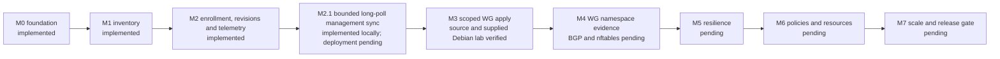

# Delivery status

## Interface/VLAN configuration increment — 2026-10-22

The Network tab provides per-interface Configure/VLANs, current IPv4/IPv6 addresses, dedicated static LAN/VLAN safe apply via the Fabric agent, a local independent 60-second rollback guard and commit history/Edit and retry. Migrations 0022/0023 and agent 0.4.0 are required. Local dedicated-interface authorization remains mandatory. WAN/DHCP management and multi-prefix advertisements remain blocked; general forwarding stays isolated. Real namespace lifecycle tests do not establish physical trunk/reboot/routed-traffic readiness. ens36 mapping and console recovery on the supplied Hub remain unknown. See [scope and evidence](operations/interface-management.md).

## Implemented M0/M1

Next.js operator login/logout, PostgreSQL scrypt credentials, signed sessions with credential fingerprint revocation, shared email limiter, auth migration, protected dashboard and liveness route are preserved.

M0 adds locked rotating change logs, isolated PostgreSQL integration/browser tests, pinned Playwright and CI configuration. Go source and a pinned Go toolchain are now part of the M2 agent implementation.

M1 adds checksum-verified serialized additive controller migrations, superadmin/admin/viewer authorization and operator provisioning (superadmins create admins or viewers; admins create viewers), persisted site/hub/branch inventory, transactional creation audit, same-origin bounded JSON operator endpoints and inventory controls/list in the existing Devices view. Device creation issues a one-use enrollment token and an initial typed desired revision. The operator flow is Devices -> Add device (Edge or Hub); internal site/network grouping remains hidden and is created transactionally with the device and audit. Devices now contains onboarding/token instructions and a server-paginated searchable table. Provisioning navigation is removed; obsolete query-based dashboard view URLs no longer select Devices. Per-device URLs reuse agent configuration/telemetry with admin writes and viewer read access. Initial dashboard inventory is bounded to 25 rows; totals cover all devices. Production-scale search performance remains unverified. Existing credentials were verified unchanged during local development migration.

Device details now group Overview, Network, SD-WAN and Advanced into accessible tabs. Admins can rename a device or archive it from the detail page. Archiving revokes credentials and withdraws active peer plans while retaining audit history and WireGuard reservations; local tunnel state may remain on a disconnected appliance until local cleanup. On Devices, admins can open **View archived**, select archived devices, and permanently delete one or multiple at once; each deletion retains its audit event and removes credentials, telemetry, and configuration history. Migration 0021 adds the permanent-deletion audit action. Apply controller migrations before deploying this version.

## Implemented management MVP (M2)
Add device issues a hashed, expiring, single-use enrollment token and initial desired revision. Next.js issues dedicated client certificates from verified CSRs, and mTLS agent endpoints trust only protected NGINX identity forwarding plus a shared upstream secret. Go agent in sdwan-edge is shared by Edge/Hub, initiates HTTPS by default, persists keys privately, stages checksummed typed desired revisions, acknowledges received/rejected, sends heartbeat/interface telemetry and renews certificates. An explicit development flag permits HTTP to private/loopback addresses; superadmin Controller Settings controls which private IP is included in generated install instructions. This exposes management traffic and is for isolated labs only. The installer and static amd64/arm64 binaries are published under Controller `public/fabric/`; a signed manifest binds the downloads, and the installer prompts for the token without echoing it before enabling a systemd service. UI status distinguishes Pending, Enrolling, Syncing, Management connected, Offline, and Revoked; latest revision receipt is shown separately. Admin recovery can rotate a consumed enrollment only before the first heartbeat. Management Configurations/Telemetry views reuse the existing design. These describe the default service and signed management release. Source 0.2.0 adds locally gated WireGuard adjacency apply below.

Received does not mean applied; management connectivity does not mean tunnel/BGP/application reachability. Source 0.2.0 implements bounded owned WireGuard adjacency apply/recovery behind a local opt-in, with namespace and supplied Debian lab evidence. Source 0.3.0 adds controller schema-v3 LAN/FRR BGP plans, local `--enable-routing --lan-interface` gating, reported BGP peer state and CLI version/help. Signed Linux `amd64`/`arm64` 0.3.0 bundles and the matching installer have now been generated into controller public assets and signature/hash verified; the dashboard lists 0.3.0 when running from this controller tree. An Actions workflow builds and commits future signed bundles after main-branch agent changes; it requires the `FABRIC_RELEASE_SIGNING_KEY` repository secret, write access to main and deployment of the generated controller commit. The new nested namespace lifecycle attempt could not start because the container shares `/proc/1` network/mount namespaces and refuses unisolated execution. BGP appliance/session verification and explicit LAN transit policy remain UNVERIFIED/pending; general nftables, policies/resources and routed failover remain pending.

## Verification
Actual per-task results and failed iterations are in [change logs](change-logs/log_change_001.md). PostgreSQL tests cover concurrent one-use enrollment, expired/replaced/revoked credentials, certificate scope, immutable revision/ack integrity, deduplication and audit rollback. The actual Go/NGINX/Next smoke verifies TLS ingress and controller communications. Original baseline and current UI evidence are retained under [evidence](evidence/README.md). Final counts/results are recorded in the milestone closure entry.

Controller Settings includes a superadmin-managed private IP allowlist for generated HTTP lab onboarding instructions. Applying migration 0007 is required. Source and signed installer artifacts are at agent release 0.1.6. Add device generates a single copy/paste command that securely pipes the one-time token through stdin; for private-IP HTTP labs it also pins and installs the HTTPS server CA before enrollment. Pending identity state can be rebound to the explicitly supplied controller origin; enrolled identities remain protected. Actual Debian host installation remains UNVERIFIED.

Controller Settings also supports a superadmin-managed IANA display time zone (migration 0017; UTC default). Dashboard timestamps and diagnostic logs use that zone while persisted timestamps and API values remain UTC.

Operator management is available in Settings with server-enforced role limits and one-time generated passwords. Enrollment API/agent integration and migration recovery tests pass. A signed static release for Linux amd64/arm64 is built into the Controller public folder. Installer behavior on an actual Debian systemd VM, live public ingress deployment, WireGuard/FRR/nftables apply/rollback/failover/reboot, and scale targets remain UNVERIFIED. Certificate renewal uses overlapping validity to tolerate lost renewal responses.

## Rollback and next step
Disable agent ingress and revert new feature bindings if necessary; preserve additive schema, inventory and audit/change logs. Apply controller migrations through 0019 before deploying current controller code. The default service and signed release make no network changes; BGP still needs the separate local activation flags. Next: configure the Actions signing secret and main-branch write policy, deploy the controller source and release 0.3.1 assets, then validate BGP over WireGuard on isolated Debian appliances.

## M2.1 — responsive management synchronization

Rama requested a dashboard–Edge communication model similar to NetBird. The controller and signed Go agent release 0.1.6 now use bounded agent-initiated HTTPS/mTLS long-poll for desired revisions while retaining Next.js and PostgreSQL. Dashboard publish uses PostgreSQL notification only as a wake-up hint; each wait checks durable state before and after waiting. Focused controller unit tests, isolated PostgreSQL wake integration, Go tests, and signed release checks pass. The Docker/NGINX/Go smoke was attempted but Docker's OCI runtime could not execute NGINX (status 126); full smoke and Debian deployment remain UNVERIFIED. This is HTTP request/response long-poll, not WebSocket/gRPC or full NetBird architecture. Signal/Relay services, peer negotiation, and network forwarding remain separate future decisions. See [control-channel implementation and limits](architecture/agent-control-channel.md) and [ADR 0003](adr/0003-event-driven-agent-management.md).

## UI consistency audit — 2026-10-12

Shared feedback styles/announcements and typed controller-status labels reduce duplicated markup. Existing Button now covers the password toggle. Device form/table semantics, mobile navigation focus and clipboard failure feedback are verified with the existing desktop/mobile browser suite. Existing theme, auth, routes, APIs and management/data-plane behavior are preserved. Component documentation and permanent root reuse policy are in place; exact verification and limits are recorded in the [UI architecture](development/ui-component-architecture.md) and change log.

Dashboard screens now use `/dashboard`, `/dashboard/devices`, `/dashboard/devices/[id]`, `/dashboard/telemetry`, and `/dashboard/settings`. The shared shell, authorization, and data services remain reused. Legacy `?view=` URLs are not preserved or redirected, per the direct route migration.

## Maintainability and diagnostics — 2026-10-12

`GET /api/health` is the liveness check. `GET /api/ready` checks PostgreSQL with a lightweight query and returns a generic 503 with a request ID when it is unavailable; it never returns driver messages. Unexpected operator and agent API errors include a generated request ID and emit structured stdout metadata with scope, sanitized error class, and constrained error code. Dashboard health/settings sections are application components under `components/fabric/` and preserve the existing markup and tokens.

## White-label branding — 2026-10-14

Controller migration 0005 adds the `superadmin` role without changing existing admin/viewer assignments and stores one bounded raster logo. Existing operators can be assigned with `npm run set:operator-role -- <email> superadmin`. Branding Settings are only rendered for superadmins, and upload/removal APIs enforce that role and same-origin requests server-side. PNG/JPEG/WebP logos are limited to 2 MiB; the Settings preview shows light and dark surfaces and recommends 600 × 180 px. The asset is displayed proportionally on the login page and dashboard navigation with the default mark when unset. Applying migration 0005 is required before deploying this code. No network or agent behavior changed.

## Runtime error reports — 2026-10-12

Next.js server errors and uncaught browser runtime errors have friendly recovery UI with a reference ID. Diagnostics persist in PostgreSQL table `runtime_errors`; `/api/runtime-errors` accepts bounded same-origin browser reports from signed-in operators, and server failures are captured by Next.js `onRequestError`. Stored message/stack fields are bounded and redacted; entries older than 30 days are pruned during report writes. Developers can inspect a reference with `npm run errors:show -- <reference-id>` from `sdwan-controller/`. Controller migration `0003_runtime_errors.sql` must be applied first. No monitoring/error-reporting dependency was added.

The read-only `/diagnosticlogs` page lists the 100 most recently updated reports for superadmins. A Diagnostics link appears in the dashboard menu only for superadmins; server-side role checks redirect admins, viewers, and signed-out users. No separate developer diagnostic user or login remains. The legacy table from migration 0004 is unused and retained because applied migrations are immutable. See the [runtime error troubleshooting guide](operations/runtime-error-troubleshooting.md).

## Management communication hardening — 2026-10-14

The shared agent now attempts renewal/heartbeat/config independently, persists pending receipt acknowledgements for restart retry, rejects unsupported verified configurations without advancing state, repairs corrupt staging caches, and avoids repeated unchanged writes/acknowledgements. Optional revision/checksum queries omit unchanged payloads while preserving device authentication/scope and full responses for legacy clients. Startup jitter and bounded HTTP connections/deadlines reduce reconnect pressure. See [operations and limits](operations/management-channel.md). Polling remains periodic; configuration/renewal failure can slow cycles via shared backoff. No streaming, network apply or production capacity guarantee is introduced.

## Superadmin device command history

Controller migrations 0012–0015 record desired configuration publication, full delivery, agent receipt/rejection, and WireGuard state changes in an immutable event trail retained for 365 days (opportunistically pruned on writes). Repeated WireGuard status reports refresh current observation but do not create duplicate history rows; migration 0015 removes consecutive duplicates already recorded. Migration 0013 imports existing desired-revision timestamps and the latest stored WireGuard observation within that window; earlier delivery/receipt and publisher details are unavailable. Migration 0014 adds superadmin-only on-demand raw snapshots of the exact serialized controller configuration, bounded to 128 KiB and excluding secrets. Device details expose filters, pagination and snapshot viewing to superadmins only; APIs enforce the current database role. Receipt is staging, not application. Failures from the current WireGuard status contract have no detailed reason, so the history shows a generic message. FRR and general nftables operations are not implemented; future operations require typed contracts, secret redaction, and device outcome reporting. See [management channel and history](operations/management-channel.md).

Migration 0016 adds a superadmin-only on-demand Configuration sources view. The agent reports known local state paths and file presence, its saved WireGuard plan, owned interface/address/up state and handshake timestamps; it never reads or sends private key contents. The latest report is retained for 24 hours, and requests time out after two minutes. Reports travel over the existing agent-initiated mTLS channel. FRR and general nftables remain reference-only and are not collected. See [management channel and history](operations/management-channel.md).

## Selected hub WireGuard adjacencies — source 0.2.0

Settings persists a superadmin-configured private tunnel pool; device details persist Hub endpoint/base port and up to eight selected Hubs per Edge. Stable /31 and port reservations are transactional, retain removed reservations, reject overlap/exhaustion/stale saves, and publish both peer plans atomically. Revocation removes active peer plans. Migrations 0008/0009 are required. The device view separates receipt, revision-scoped local apply and timestamped handshakes. The illustrative preview no longer has a competing hub selector.

Go source 0.2.0 adds local `--enable-wireguard`, private keys, typed owned WireGuard operations, route/interface/controller-address preflight, durable previous-plan recovery, management confirmation and separate status reporting. Startup restores local state before controller access. Signed installer release 0.2.0 includes the source features; the default service remains unprivileged and does not enable WireGuard. Existing devices require a host-initiated upgrade. Optional NET_ADMIN activation needs isolated Debian validation.

A disposable namespace test exercised one Edge/two Hubs with real handshakes/pings, management-confirmation rollback, interface-loss restoration, interrupted-journal recovery and peer removal with intact underlay. Controller/browser/Go results are in the task log. This is not a Debian reboot test. The supplied Debian deployment/systemd/reboot and real mTLS-to-kernel path now have evidence below. NAT, sustained traffic/MTU, arbitrary process-kill/disk faults, general BGP/nftables/LAN policy and automatic hub failover remain UNVERIFIED. See [activation/recovery](operations/wireguard-tunnels.md) and [ADR 0004](adr/0004-wireguard-adjacencies.md).

### Debian lab activation

The user-provided Debian 13 Hub 192.168.160.142 and Edge 192.168.160.141 now run source 0.2.0 through explicit capability drop-ins. Controller migrations 0008/0009 were applied. Automatic allocation produced Hub 10.250.0.0/31 and Edge 10.250.0.1/31, UDP 22000. Real handshakes, bidirectional tunnel ping, mTLS key/status exchange, applied observations and ens33 management reachability were verified. Because both hosts already forward IPv4, an owned group-scoped nftables guard blocks tunnel transit; positive/negative namespace tests verified it. Broader nftables policy remains pending. The installer/signed release remains 0.1.6. See the final task log for recovery/reboot outcomes and remaining evidence limits.

Final supplied-lab checks passed actual Edge/Hub reboot persistence and Edge local interface recovery with controller HTTPS blocked. After both reboots, Hub tunnel ping passed 3/3 and Edge passed 5/5; both desired/observed revisions match with applied status and real handshake timestamps. Final targeted desktop/mobile browser regression passed 8/8 and production build passed. Earlier broad browser attempts had navigation/login instability; the preview focus expectation was corrected to match existing Modal focus order, then the targeted suite passed. No full-browser or fleet-capacity claim is made.

## Routed LAN increment — milestone 1

Migration 0010 and controller services/UI add audited saved LAN interface/address/advertisement profiles and protected management/underlay networks. Source and signed 0.3.0 publish schema-v3 plans with exact LAN prefix filters over selected WireGuard peers and store reported BGP peer states in migration 0018. Local apply requires an explicit interface and routing opt-in. Go checks and FRR 10.3 syntax validation pass; BGP namespace lifecycle and appliance sessions remain UNVERIFIED. The tunnel transit deny remains active; host-to-host LAN forwarding is not enabled. See [delivery guide](operations/routed-lan.md).

## Controller-agent communication reliability — source work in progress

The source controller and Go agent now have bounded diagnostic reports, durable diagnostic wake-up, independent sequential heartbeat/renewal/desired retry deadlines, typed redacted transport errors, required-core-schema readiness, and distinct controller-timeout versus agent-collection-failure report reasons. Migration 0019 adds the nullable reason field. The Go changes are now packaged in signed Linux amd64/arm64 0.3.1 bundles and the matching installer in controller public assets; immutable 0.3.0 predates these fixes. Deploy the matching controller source and migrations through 0019 before device upgrades. No appliance rollout or live incident correlation is claimed. Controller unit/integration/lint/typecheck/build, Go tests/race/vet/build, and the targeted desktop/mobile browser test pass. The Docker transport smoke, live incident correlation, and canary remain UNVERIFIED. See the [execution plan and evidence ledger](development/controller-agent-communication-plan.md) and [management channel operations](operations/management-channel.md).

## Confirmed replacement enrollment — 0.3.2

Signed Linux amd64/arm64 0.3.2 bundles and the matching default installer are prepared in controller public assets. They include the later management-route wiring and local diagnostic/status changes, plus explicit terminal-confirmed replacement enrollment. The installer verifies the new identity before cleanup, snapshots old private state/service/binary/overrides, removes only the old owned network bundle through the existing locked engine, retires old fabric-agent overrides and starts the new identity in management-only mode. No unattended identity reset or general host-network flush is introduced. Prior signed bundles are unchanged. Unit/failure-injection and WireGuard/FRR namespace evidence are recorded in the change log; real Debian systemd replacement, restart/reboot rollback and live deployment remain UNVERIFIED. See [agent installation](operations/agent-installation.md#confirmed-replacement-enrollment-032).

## WireGuard draft/deploy workflow

Controller source adds persisted drafts and explicit publication for Hub endpoints and Edge Hub connections. Saving drafts does not change active topology or agent revisions; Deploy publishes both peers atomically through the existing topology owner, with version conflicts, current-role rechecks and idempotent no-draft retries. Status distinguishes receipt, local activation/apply and observed handshakes and provides next steps. Migration 0020 is required before controller rollout. Local network privileges, agent release assets and appliance routing/forwarding boundaries are unchanged. Copy deployment report is controller-observed context, not full remote service-log diagnostics. See [operations](operations/wireguard-tunnels.md#draft-and-explicit-deployment-workflow).

### Simple local activation (0.3.6)

Agent source adds root-only `network enable` / `network status`, preserving service arguments/state/identity and using the existing read-only preflight. One local systemd override enables WireGuard only; controller authentication is checked before/after restart, and normal service failures restore the prior override. The SD-WAN activation tip is conditional on a current disabled observation and disappears once active. Documentation covers post-enrollment activation and older-agent upgrades. Signed Linux 0.3.6 bundles are prepared with an unprivileged default service; no appliance rollout is performed. Go failure/race and isolated WireGuard lifecycle checks plus desktop/mobile browser verification are recorded in the change log. Real Debian activation/reboot/failure canaries and live Edge2 connectivity remain UNVERIFIED. See [operations](operations/wireguard-tunnels.md#local-activation-gate).

The 0.3.6 activation hotfix initializes the default typed command runner before
read-only preflight. Releases 0.3.4/0.3.5 can panic before any activation service
change; upgrade affected devices to 0.3.6 while retaining enrollment. Regression
coverage now includes a nil-runner reproduction and real default-runner iproute2
inside the isolated lifecycle test. Real appliance activation remains UNVERIFIED.

Source adds controller-managed transit allow rules (migration 0024, Settings → Transit policy, schema-v4 `routing.transit`) and a local agent `--enable-transit` gate that renders them ahead of the owned tunnel forwarding guard. Default denial is unchanged without rules or the flag. Go and controller unit/integration tests pass; namespace forwarding lab, browser spec and physical appliance traffic are UNVERIFIED. See [Routed LAN](operations/routed-lan.md#transit-allow-rules-milestone-3-source).
