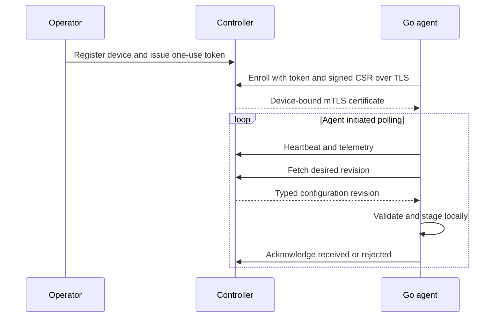

# ADR 0002 — Agent-initiated HTTPS management channel

Status: Accepted within Rama's enrollment/agent/channel request, 2026-10-12. Extends ADR 0001; Next.js remains the controller API.

Agents initiate HTTPS request/response polling so Edge devices behind NAT/CGNAT need no inbound management port. Operator publish stores immutable desired revisions; agent polling retrieves them. Agent sends telemetry/heartbeat and received/rejected acknowledgements. HTTP/1.1 keep-alive is sufficient for MVP; streaming/WebSocket/gRPC is deferred until measured latency/scale needs justify it.

Bootstrap uses a 15-minute, hashed, scoped, single-use token and a signed CSR. A dedicated CA issues 30-day mTLS certificates bound to the registered node. NGINX validates client certificates and strips identity headers; Next.js trusts only a private ingress shared secret plus verified serial and checks current revocation/expiry on every request. Renewal proves the enrolled key; overlap avoids invalidating the old certificate before a renewal response is persisted. A consumed-token response loss needs operator recovery; it is not silently treated as a second enrollment.

Typed initial configuration contains schema version, device kind, recorded routing mode/LAN prefix and polling interval. It is staged locally and acknowledged received, never applied. Arbitrary shell/config text is rejected. Actual WG/FRR/nft apply, LKG rollback and network verification remain later milestones.

Retries use jitter/backoff and stable pending heartbeat IDs. Controller bounds payloads, retains 100 telemetry samples per device and uses retained-event deduplication. Long-delayed retries outside retention are new observations; this is not a permanent event archive. Freshness is derived from three polling intervals with a 120-second floor. TLS, cryptographic identity and actual connectivity are tested locally; production ingress, Debian/systemd, scale and data-plane behavior require separate evidence.
