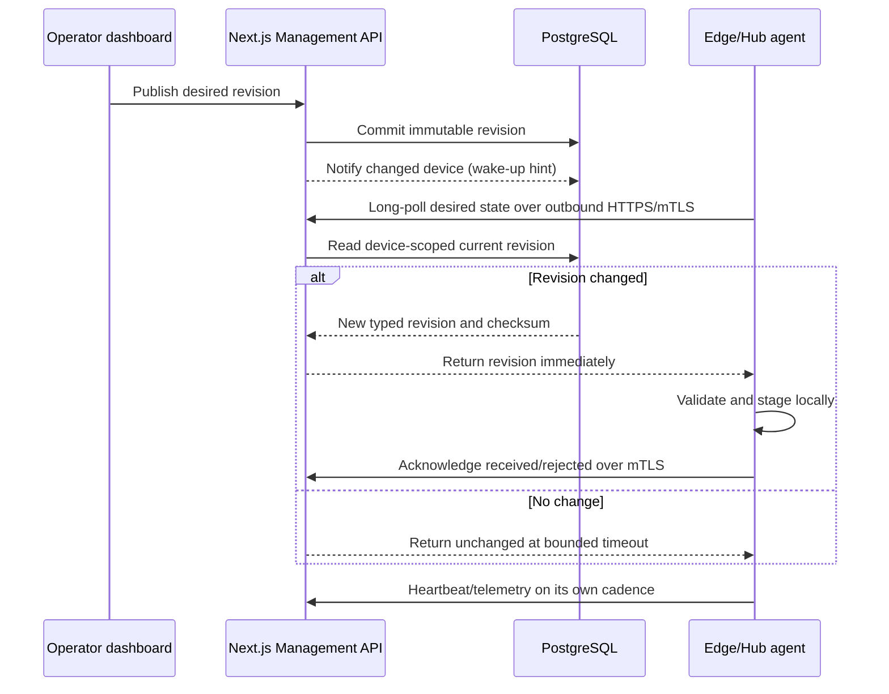

# Agent control channel target

## Goal

Make the dashboard-to-Edge control loop responsive and recoverable, following the useful Management/peer pattern in NetBird while keeping PacketMotion's existing Next.js controller and PostgreSQL. PacketMotion implements that management behavior with a bounded long-poll; this does not reproduce NetBird's separate Signal and Relay services.

NetBird's public architecture separates Management (identity/configuration), Signal (peer coordination), and Relay (fallback transport). PacketMotion adopts the separation of control from forwarding, not those services wholesale. See [How NetBird Works](https://docs.netbird.io/about-netbird/how-netbird-works).

## Decision

Use an agent-initiated HTTPS/mTLS long-poll for desired-revision changes, with the existing request/response APIs for enrollment, heartbeat, acknowledgement, and renewal. A long-poll waits for a bounded interval and returns immediately when a newer revision is available. The agent reconnects with jitter and supplies its last known revision/checksum, so a lost notification cannot lose configuration.

The existing Next.js application remains the Management service and PostgreSQL remains durable source of truth. Do not add a separate Go controller, broker, Signal service, or Relay service for this increment. Do not use WebSocket/gRPC streaming unless long-poll evidence shows a measured limitation that justifies the additional server/runtime and deployment complexity.

The agent maintains one outstanding desired-state wait per device. The controller may use PostgreSQL `LISTEN/NOTIFY` as a wake-up hint after a committed publish; notifications carry only a device/revision identifier and are never authoritative. Every wait begins with a database read, and every timeout/reconnect reads durable state again. If notifications are unavailable, bounded timeout/re-read still converges.

## Message flow

The implementation reuses the existing desired endpoint with a bounded `wait` request parameter. Each wait starts with an authoritative database read and can be woken by a committed publish. Heartbeat and certificate renewal occur in the agent's preceding management cycle, so neither is held open by the desired-state wait. No PostgreSQL transaction is held while waiting. The controller bounds one waiter per authenticated node per process, total waiters, and request duration. NGINX proxy timeouts exceed the application wait.

## Reconnect, outage, and security behavior

- A long-poll returns immediately for a new revision; otherwise it ends within 25 seconds. Agent reconnect uses exponential backoff with jitter and a cap.
- PostgreSQL state, not notifications or in-memory waiter state, determines the revision. Controller restart, lost notification, or agent restart therefore converges on the next request.
- Desired revisions remain immutable and device-scoped. Existing schema/checksum/type validation, staging, and received/rejected acknowledgements remain authoritative.
- Keep enrollment one-time, short-lived, and token based. Use the issued device certificate for mTLS after enrollment. Never fall back to HTTP for field management traffic or disable certificate verification.
- Forwarding remains local to Edge/Hub and must continue during controller loss. Do not represent received/staged as applied; later apply work needs its own journal, last-known-good state, verification, and rollback.
- Do not add arbitrary RPC, shell execution, or a controller-to-edge inbound connection.

## Dashboard status model

Keep the current separation between enrollment, management freshness, and revision receipt. Add separate evidence only as the corresponding implementation arrives:

1. **Enrollment:** no identity / enrolled.
2. **Management:** last authenticated heartbeat, freshness, and last control-channel contact.
3. **Configuration:** desired revision / received or rejected acknowledgement; `applied` appears only after a future privileged apply milestone supplies proof.
4. **Network:** tunnel, BGP, and routed-reachability states only after real probes and lab evidence exist.

The dashboard never reports a healthy peer tunnel solely because the agent is online or has acknowledged a revision.

## Delivery stages and acceptance

1. **Contract and instrumentation:** record request duration, wait outcome, wake-up delay, reconnect count, and safe error classes without tokens, certificates, or payloads. Define fleet target and connection/database budget before implementation.
2. **Controller wait path:** authenticated node scope, immediate return for newer state, bounded wait, durable re-read after wake/timeout, per-node waiter limits, and fallback when LISTEN disconnects.
3. **Agent loop:** run heartbeat/renewal independently from the long-poll; validate/stage/ack idempotently; reconnect after timeout, TLS failure, controller restart, and network interruption.
4. **Dashboard evidence:** show last heartbeat, last sync, desired revision, acknowledgement, and freshness separately; preserve existing roles and responsive UI.
5. **Verification:** unit tests for races and timeouts; isolated PostgreSQL/NGINX/Go tests for publish while waiting, notify loss, duplicate wakeups, expired/revoked certs, controller restart, stale revision, and recovery; measure target fleet load and p95/p99 wake-up latency. Debian VM evidence is required for service restart/reboot. Forwarding-survival tests belong to the later network lab.

Acceptance requires a published revision to reach a connected agent promptly without waiting for the ordinary telemetry interval; a disconnected agent must retrieve the latest durable revision on reconnect; duplicate/lost notifications must not duplicate or skip state; heartbeat and certificate renewal must continue while a wait is outstanding; controller loss must not change forwarding; all mTLS, node-scope, revocation, and payload bounds must remain enforced.

Rollback is controller-first compatible: stop waiting and return the current full/unchanged response, then roll agents back to periodic polling. Retain identities, revisions, acknowledgements, audit records, and migration history. No destructive schema rollback.

## Current implementation boundary

The current Go release (0.1.6) sends heartbeats at the configured cadence and waits up to 25 seconds on the existing HTTPS/mTLS desired endpoint between them. A pending enrollment key can be rebound to the explicitly supplied controller origin; enrolled identities cannot. Publishing from the dashboard commits the immutable revision and wakes the agent through PostgreSQL notification; the agent reads and stages the typed revision and acknowledges `received` or `rejected`. Reconnects and timeouts reread durable state. Older agents remain compatible because the `wait` parameter is optional. This is bounded long-poll request/response, not WebSocket/gRPC streaming. PostgreSQL listener behavior and actual agent wake-up are covered by focused unit and database integration tests; the full NGINX/Go isolated smoke did not run successfully in this environment. Debian service recovery, fleet capacity, p95/p99 wake latency, and forwarding are unverified. There is no Signal service, Relay service, or implemented WireGuard/BGP forwarding. See [ADR 0002](../adr/0002-agent-management-channel.md) and [management-channel operations](../operations/management-channel.md).
