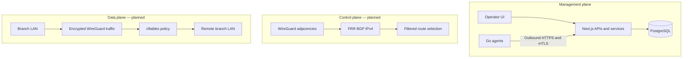

# Network Design — L3 MVP

## Planes


Management: Next.js UI -> server-only controller services/PostgreSQL; Go agents on both hubs and branches initiate authenticated outbound HTTPS requests to Next.js Route Handler APIs. No customer data forwarding via controller.
Control: FRRouting BGP IPv4 unicast, explicit route filters and deterministic preferred/backup policy. Proposed ASNs hubs 65000, branch A 65001, branch B 65002.
Data: Linux IP forwarding and nftables over WireGuard encrypted branch-to-hub tunnels. Hub forwarding provides branch-to-branch reachability.

## Logical topology
```text
                      Controller (management only)
                       /   |     |     \
                   Hub1  Hub2  Branch1 Branch2  [agents]
                     | \ / |     |      |
                     | / \ |     |      |
                     +------ Branch1 --- Branch2
                  each branch has WG tunnel to each hub
            customer packets: Branch1 -> selected Hub -> Branch2
```
The diagram is conceptual, not an interface wiring plan. No direct branch-to-branch tunnel is required for MVP.

## Selected hub adjacency implementation

Source 0.2.0 implements selectable Edge–Hub WireGuard /31 adjacencies behind a local activation gate, with namespace evidence. The default signed management service is unchanged. See [ADR 0004](../adr/0004-wireguard-adjacencies.md) for ownership/allocation and [operations](../operations/wireguard-tunnels.md) for activation/recovery. BGP, nftables and routed LAN forwarding remain planned.

## Requirements before broader network configuration
- Confirm real Debian, FRR, WireGuard, nftables versions and NIC inventory.
- Design unique overlay addressing, peer endpoints and separate hub tunnel interfaces where appropriate.
- Prove branch routes to both hub tunnel endpoints and valid return routes.
- Define hub-to-hub reachability, BGP advertisements, AS-path and next-hop policy, including hub failover behavior.
- Establish explicit source/destination policies and management exception.
- Validate MTU/MSS, route withdrawal and reconvergence under failure.
- Define how host routes reach the PacketMotion branch appliance in subnet-router mode.

## Future-proofing
Keep a generic service-type field in controller data model if useful; do not implement EVPN or VXLAN in MVP.
