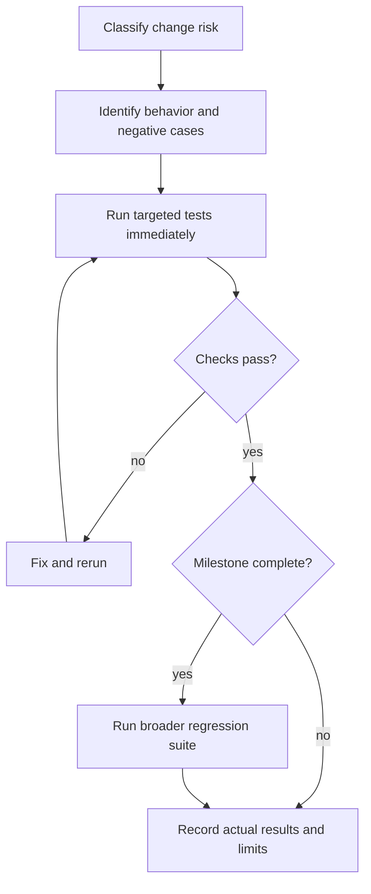

# Testing Strategy — Risk-Based and Immediate

## Principle
Test critical behaviors, not every function. Use existing frameworks if available; default Go built-in `testing`, the existing Node test runner and TypeScript compiler for controller tests, limited Playwright for essential user journeys. Avoid arbitrary coverage quotas.

## Required priority
Critical: auth/authorization, enrollment, WireGuard config and AllowedIPs, FRR route generation/filtering, nftables policy enforcement, failover, config rollback and persistence. Run targeted unit tests immediately after changes; use isolated network integration/failure simulations for behavior that mocks cannot prove.
High: API validation, migrations, config revision integrity, agent reconciliation. Use unit/integration tests as applicable.
Medium: health and diagnostics logic; focused tests for state transitions and evidence.
Low: presentational components, icons, static copy, CSS; lint/typecheck, smoke or visual review where appropriate.

## Mandatory workflow

1. Classify change risk; identify meaningful behavior and negative cases.
2. Add/update focused tests, preferably reproduce bugs before fixing them.
3. Execute targeted tests immediately after implementation.
4. Fix failures; record exact commands and actual outputs/status.
5. Run broader regression suite at milestone completion; full critical suite before release.
6. Mark unavailable or skipped checks UNVERIFIED; never imply PASS.

## Network integration scenarios
Two hubs, two branches, controller, two LAN hosts in isolated VMs or namespaces: dual WG tunnels, BGP sessions, approved/denied routes, authorized/blocked traffic, NAT branch, primary hub failure, controller outage, reboot persistence, invalid-config rollback. Capture before/after routes and session state. Never run destructive network tests on production.

## CI gates
PR: lint, typecheck, targeted unit/integration, API contracts. Milestone: regression and relevant network tests. Release: full critical network failure and security scenarios, build and recovery evidence.
