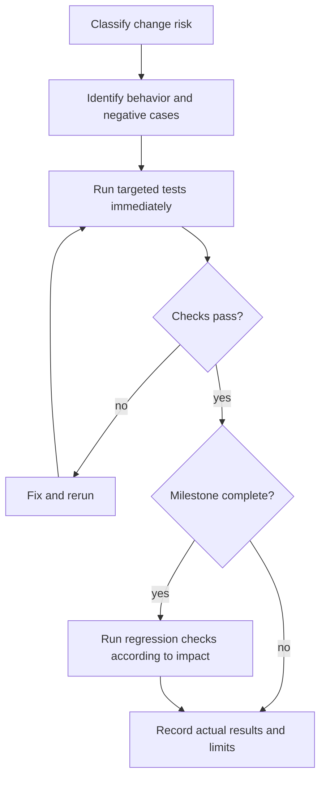

# Testing Strategy — Risk-Based and Immediate

## Principle
Test critical behaviors, not every function. Use existing frameworks if available; default Go built-in `testing`, the existing Node test runner and TypeScript compiler for controller tests, limited Playwright for essential user journeys. Avoid arbitrary coverage quotas.

## Two-stage verification

### During iteration

Choose the smallest checks that can establish correctness for the change; do not automatically run a browser suite after every edit.

| Change | Immediate verification |
| --- | --- |
| Documentation only | Review the diff and run scoped `git diff --check`; no application suite required. |
| Controller logic/API | Focused unit tests and relevant integration tests for persistence, authorization, and API boundaries. |
| Go agent | Relevant Go tests; include race/failure checks when concurrency or recovery is affected. |
| UI | Inspect the affected page and interactions; use focused logic tests, lint/typecheck, or browser tests according to risk. |

Run targeted tests immediately after critical changes; do not postpone security or recovery checks until feature completion. Manual page inspection is useful feedback but does not count as an automated browser test.

### At feature completion and delivery boundaries

- Targeted automated browser tests are required when login, sessions, roles, navigation, or enrollment forms change. Include relevant success and denial/failure behavior; server-side authorization tests remain required where affected.
- Layout, CSS, and shared UI component changes require visual verification of affected views and relevant responsive states using the existing visual tooling where available. Record the method and results; do not silently regenerate baselines to accept a regression.
- At milestone completion or before merge/release, broaden regression checks according to impact. A browser suite is not required for unrelated backend or documentation changes. Preserve the applicable security, recovery, and isolated network evidence gates below.
- Do not repeat a passing check unless later changes, failures, environment changes, or new evidence affect its validity. Record which revision/state was checked when reusing a result.
- Report actual commands and outcomes, reasons for skipped checks, and UNVERIFIED status for unrun tests or unproven behavior. An out-of-scope suite need not run; an unavailable required check remains an explicit verification gap.

## Required priority
Critical: auth/authorization, enrollment, WireGuard config and AllowedIPs, FRR route generation/filtering, nftables policy enforcement, failover, config rollback and persistence. Run targeted unit tests immediately after changes; use isolated network integration/failure simulations for behavior that mocks cannot prove.
High: API validation, migrations, config revision integrity, agent reconciliation. Use unit/integration tests as applicable.
Medium: health and diagnostics logic; focused tests for state transitions and evidence.
Low: presentational components, icons, static copy, CSS; lint/typecheck, smoke or visual review where appropriate.

## Mandatory workflow

1. Classify change risk; identify meaningful behavior and negative cases.
2. Add/update focused tests, preferably reproduce bugs before fixing them.
3. Execute the smallest relevant checks during iteration; immediately test critical changes.
4. Fix failures; record exact commands and actual outputs/status.
5. At feature completion, run required targeted browser/visual checks above. Run broader regression checks according to impact at milestone completion or before merge; retain the full applicable critical suite before release.
6. Record reasons for skipped checks and mark unrun tests or unproven behavior UNVERIFIED; never imply PASS. Reuse passing results only while they remain valid.

## Network integration scenarios
Two hubs, two branches, controller, two LAN hosts in isolated VMs or namespaces: dual WG tunnels, BGP sessions, approved/denied routes, authorized/blocked traffic, NAT branch, primary hub failure, controller outage, reboot persistence, invalid-config rollback. Capture before/after routes and session state. Never run destructive network tests on production.

## CI gates
PR: lint, typecheck, targeted unit/integration, API contracts. Milestone: regression and relevant network tests. Release: full critical network failure and security scenarios, build and recovery evidence.

## Repository commands and evidence boundary
The controller package provides `npm test`, `npm run test:integration`, `npm run test:browser`, `npm run test:visual`, and `npm run test:agent`, plus lint, typecheck and build. `test:agent` provisions isolated PostgreSQL/PKI and a test Next.js + NGINX ingress, builds and exercises the real shared Go agent; it requires Docker, OpenSSL and Go 1.27.2. It verifies the management channel and proxy boundary only. It does not verify Debian/systemd deployment or WireGuard, FRR, nftables, routed traffic, rollback, failover or reboot behavior.

Run Go checks from `sdwan-edge/`: `go test ./...`, `go test -race ./...`, `go vet ./...`, and `go build ./cmd/fabric-agent`. The repository pins Go 1.27.2. Always report the commands actually run and their real outcome; repository documentation and a successful management smoke are not evidence that pending network scenarios passed.

The locally gated WireGuard engine has a separate opt-in [namespace lifecycle check](../operations/wireguard-tunnels.md#reproducible-isolated-check). Ordinary Go tests skip it; report actual execution separately. It does not substitute for Debian/systemd, NAT, LAN forwarding, BGP or full proxy-to-kernel evidence.
