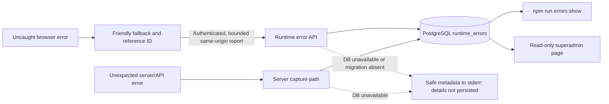

# Runtime error troubleshooting

The controller shows a friendly recovery screen when an unexpected runtime failure escapes normal handling. The screen provides a reference ID that developers can use to find the corresponding diagnostic. It does not expose the exception message or stack to the operator.

## Find a diagnostic

Run this from the `sdwan-controller/` directory on a host configured with the controller's `DATABASE_URL`:

```sh
npm run errors:show -- <reference-id>
```

Review the record's source, route and method, sanitized error name/code, occurrence count, timestamps, message, and stack. Server render errors use Next.js' error digest as the reference. Client and API error paths generate reference IDs. The CLI reads one record by reference; there is no public diagnostic log browser.

Treat the output as sensitive operational data. Values are length-bounded and known secret patterns are redacted, but sanitization cannot recognize every possible application secret. Restrict access to the database and CLI, and inspect output before including it in an issue or sending it to another person. The reporting system does not intentionally record credentials, tokens, cookies, request bodies, or query strings.

## Capture coverage and limits



- Next.js route/render failures are presented through the app's error boundary. Server-side request failures are captured by Next.js instrumentation.
- Uncaught browser errors and unhandled promise rejections trigger the friendly fallback and a bounded same-origin report. The report endpoint requires a signed-in operator and validates the submitted fields.
- Unexpected operator and agent API failures carry their request/reference ID in their error response and persist diagnostics through the controller's server-side logging path.
- Expected validation failures and API errors handled by a feature's normal UI state are not uncaught runtime failures and do not necessarily create a runtime error record.
- Messages and stacks are bounded and redacted before persistence. Records older than 30 days are eligible for best-effort cleanup during error writes; cleanup is not a scheduled job and can be delayed while no errors are written.
- If PostgreSQL is unavailable or migration `0003_runtime_errors.sql` has not been applied, the user-facing fallback still works. The process emits safe metadata to stderr, but detailed diagnostics cannot be persisted or retrieved by the CLI.

## Deployment and verification

Apply controller migrations before rolling out a version that uses runtime error storage:

```sh
cd sdwan-controller
npm run migrate:controller
```

The migration runner is repeatable and checksum-verifies applied migrations. Do not edit an applied migration; introduce a new additive migration if the diagnostic schema needs to change. Confirm database availability with the existing readiness endpoint, then use a reference ID and `npm run errors:show` to inspect reports. Do not create production test failures to validate capture; use the focused tests in the controller test suite.

The feature uses the existing Next.js instrumentation, controller API, PostgreSQL connection, and CLI. It adds no third-party error-reporting library or external telemetry service.

## Web access

The read-only web view is available at `/diagnosticlogs` to superadmins from the dashboard Diagnostics menu item. Admins, viewers, and signed-out visitors are redirected to the dashboard or login page. Authorization reads the operator's current role from PostgreSQL on each page request, so role changes take effect without waiting for a session refresh. There is no separate diagnostic login or developer account. The page shows up to 100 latest reports. Each row's **Copy report** action copies the reference ID, first/last seen times in UTC, occurrence count, source, route/method, error name/code, message, and stack trace as plain text. This provides context for an operator or AI agent; review the report before sharing it because diagnostics may still contain sensitive application context. Stack details remain expandable per row. The page is read-only and exposes no log deletion or mutation operations.
