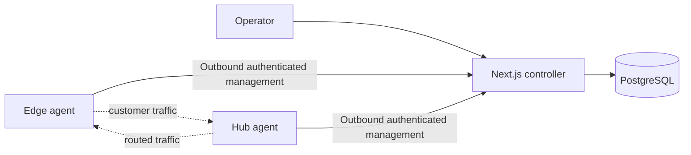

# PacketMotion Fabric — PRD v1.1

Status: Engineering handoff draft | 2026-10-12 | L3-first, EVPN-ready

Delivery status is tracked separately in [docs/STATUS.md](../STATUS.md). This PRD remains the target scope: requirements below do not imply that corresponding network-plane behavior has shipped.

## Vision
Secure, centrally managed branch connectivity with low-touch onboarding, useful remote resource access, dual-hub resilience, and actionable diagnostics. Primary users: SMB IT administrators and managed service providers. The product is not a complete SD-WAN replacement.

## Existing application constraint
The repository already has a Next.js app, authentication, dashboard and visual template. They are protected and must be extended, not replaced. Determine actual auth provider, design tokens, routes and component patterns by inspection.

## MVP deployment
One controller (Next.js UI and Route Handler APIs, PostgreSQL), two Debian hubs, two Debian branches, two test LAN hosts. Single-customer deployment. Go agents connect outbound to controller with authenticated, encrypted management channels. Controller is never in customer packet path.

The solid management paths do not carry customer packets. The dashed paths represent the planned L3 forwarding plane; the current management MVP has not implemented it.

## P0 functional requirements
- FR-001 Site/node/hub inventory and health overview.
- FR-002 Secure, expiring, single-use device enrollment and revocation.
- FR-003 WireGuard branch-to-both-hubs transport, including branch behind NAT/CGNAT (outbound initiated).
- FR-004 FRRouting BGP IPv4 unicast route exchange with explicit allowed prefixes and route filtering.
- FR-005 Deterministic preferred-hub routing and verified alternate-hub recovery; no controller dependency for failover.
- FR-006 Gateway Mode and Subnet Router Mode with explicit return-route requirements; one-NIC subnet router supported.
- FR-007 Central, least-privilege, default-deny intersite access policies via nftables.
- FR-008 Desired-state configuration, validation, revisions, safe apply and last-known-good rollback.
- FR-009 Telemetry: agent, tunnel handshake, BGP session, route presence, resource reachability and event history.
- FR-010 Resource catalog (PC, NVR, server, custom TCP/UDP service) and authorized routed access; no promise of browser-based remote desktop.
- FR-011 User-facing diagnostics with evidence, timestamps and confidence/uncertainty, not unsupported root-cause claims.
- FR-012 Audit trail and operator roles integrated with existing auth.

## P1 / future
P1: subnet overlap translation, Windows endpoint agent, multi-WAN failover. P2: direct spoke-to-spoke, BGP EVPN/VXLAN L2 extension. Do not implement these in MVP.

## Core user flows
1. Admin creates site, selects gateway or subnet-router mode, supplies WAN/LAN, hub preferences and permitted prefixes.
2. Admin creates expiring enrollment credential; agent enrolls, authenticates and receives validated desired state.
3. Agent safely applies WireGuard, FRR and nftables configuration; reports verification and applied revision.
4. Dashboard displays actual site/tunnel/routing/resource health using existing UI design.
5. Operator registers resource and authorizes access by source, destination, protocol and port.
6. During primary hub failure, existing node logic and routing converge to alternate hub without controller involvement; event evidence is recorded when management connectivity resumes.

## Network assumptions requiring validation
- Two hubs are reachable public endpoints; branch devices can initiate WireGuard to each hub.
- Proposed lab ASNs: hubs AS65000, branch1 AS65001, branch2 AS65002. Hubs require explicit route exchange and policy design; same ASN alone does not make inter-hub transit work.
- Use distinct tunnel interfaces or validated AllowedIPs/routing design to avoid ambiguity. BGP next-hop and forwarding must be tested end-to-end.
- Overlapping branch LAN prefixes are rejected in MVP; NAT translation is deferred.
- Customer LAN routing is possible only if PacketMotion is gateway or return routes are installed; one-NIC presence alone does not grant reachability.
- WireGuard/BGP health must not be equated with application reachability.

## Non-functional requirements
- Established forwarding persists through controller outage and reboot.
- Config apply is atomic where practical and recoverable; rollback cannot depend solely on controller reachability.
- Least-privilege services, key protection, auditable changes, structured logs with secret redaction.
- Target lab enrollment <5 minutes after WAN available; failover <30 seconds under defined controlled conditions; rollback <60 seconds after failure detection. These are aspirational targets, not guarantees.
- Design for at least 2 hubs + 10 branches in repeatable lab tests before pilot; baseline is 2 branches.

## Acceptance criteria
- Two branches establish WireGuard and BGP to both hubs, including a NAT-simulated branch.
- Authorized LAN host-to-host traffic works via preferred hub; denied traffic is blocked.
- Prefix filters reject unauthorized advertisements.
- Hub1 failure leads to successful forwarding via hub2; recovery and route behavior are observed.
- Controller outage does not interrupt existing traffic.
- Invalid network config fails safely with preserved management access and rollback.
- Restart preserves intended network configuration.
- Existing auth/dashboard/UI are functional and visually consistent.
- Logs never expose private keys; all controller-initiated changes are audited.

## Release gate
All P0 scenarios pass in isolated lab with captured evidence; no unresolved critical security or recovery defect; install, rollback and operator documentation are complete. Production readiness requires separate pilot verification.

## Controller architecture alignment — 2026-10-12
Accepted by Rama: Next.js owns controller UI/API and PostgreSQL-backed domain services; Go runs on hubs/branches. See ADR 0001. Agents use outbound polling with jitter/backoff, revision-aware retrieval and bounded telemetry batches. Operator sessions and device identities are separate; agent mTLS is verified at a trusted proxy with a protected upstream and application-level revocation checks. Deploy the controller as an always-on Node service/container. Preserve all P0 requirements and existing UI/auth. Scale is a measured release criterion; no maximum device count is promised.

## Current implementation boundary
The delivered management MVP includes operator inventory, one-use enrollment, trusted-proxy mTLS device identity, desired revision retrieval and receipt/rejection acknowledgements, certificate renewal, heartbeat/interface telemetry, controller runtime-error reporting, and read-only superadmin diagnostics. Agent configuration is validated and staged locally but is not applied. WireGuard/FRR/nftables generation, local safe apply/rollback, routed reachability, policies/resources, and hub failover remain planned and require lab evidence before release claims.
